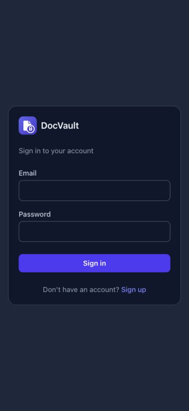
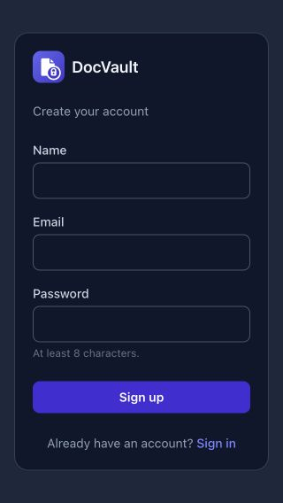
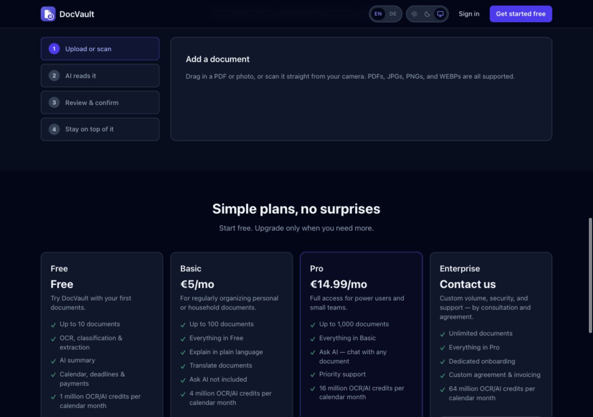

# Mobile interface check — 30 October 2026

Local source preview only. The user explicitly chose to continue without a signed-in visual check. Public screens were inspected with the in-app browser. Page width equaled viewport width in DOM measurements at 320px, 375px and 1280px; this is not a claim that every authenticated page has been visually verified.

1. **Landing navigation — fixed.** Sign in was hidden on small screens. Both account links are now visible; settings and links wrap into rows. At 320px the brand becomes compact. English and German were inspected. Theme controls remain fairly small touch targets; physical-device usability and full accessibility compliance were not assessed.

2. **Sign-in form — visually fits.** Labels, fields and submit action fit at 375px, and DOM width was checked at 320px. The form keeps its return route, redirects already signed-in users, and displays the inactivity message. No credentials were submitted.

3. **Sign-up form — visually fits.** All fields and the account link fit at 320 × 568. Account creation was not submitted.

4. **German landing navigation — visually fits.** At 320px all header controls are visible; longer hero text wraps naturally and the page scrolls vertically.

5. **Pricing — visually fits, allowances added.** The Basic card fits a 320px-wide viewport, including its credit allowance and action. Light theme was inspected. Enterprise contact now opens an email instead of sending visitors to signup. In the signed-in billing code, existing paid subscribers use Stripe Portal for plan changes to avoid starting duplicate subscriptions, and Free users no longer see a subscription-management action.

6. **Desktop pricing — layout retained.** All four columns fit at 1280px. Vertical scrolling is expected.

7. **Signed-in screens and sign-out — source checked, visually unverified.** Added wrapping/min-width fixes to the shared shell, scrollable navigation, Escape/close actions, native modal focus management, responsive form rows, and an Agenda default for narrow calendars. Manual sign-out has busy/error states. Inactivity boundary tests cover exactly ten minutes and resume/reload calculations; no live authenticated ten-minute session was exercised. Browser code enforces inactivity, not a server JWT timeout.

Validation: production build passed; 44 Vitest tests passed; local PGlite SQL tests passed; all three changed Edge Function entry points passed Deno type checking. Lint has five existing warnings in unrelated hooks/reminder code. Vite reports the existing large-bundle warning. Live OCR quality, subscription checkout, server concurrency and real mobile keyboards remain staging checks. See ../../docs/pricing-review.md for unit economics and deployment order.
